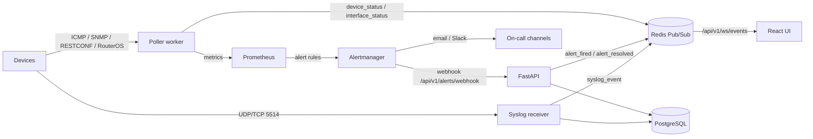

# Phase 3: Alerting, Syslog, and Live Updates

This phase connects three event sources — Prometheus alerts, Alertmanager
webhooks, and device syslog — to PostgreSQL, Redis, the WebSocket API, and the
React UI. It works the same way for `generic_snmp`, `mikrotik`, and `cisco`
devices because alert rules and live events use collector-neutral labels.

## End-to-end flow



## Alert rules

`deploy/prometheus/alerts.yml` defines four rule groups. Every rule aggregates
with `max by (device, site)` — or `max by (device, interface, site)` for
interfaces — before joining `device_parent_info`, so emitted alerts carry only
low-cardinality labels: `device`, `site`, `severity`, plus `device_id`,
`parent_device`, and `parent_device_id` from the info gauge.

| Group | Alert | Condition (summary) | For | Severity |
|---|---|---|---|---|
| `mgkk-reachability` | `DeviceDown` | `device_up == 0` | 2m | critical |
| | `HighLatency` | mean latency > 150 ms | 5m | warning |
| | `HighPacketLoss` | packet loss > 5% | 5m | warning |
| `mgkk-interfaces` | `InterfaceDown` | admin up, oper down | 2m | warning |
| | `RisingInterfaceErrors` | `rate(interface_in_errors_total[5m]) > 0` | 5m | warning |
| | `CRCFcsErrors` | `rate(interface_crc_errors_total[5m]) > 0` | 5m | warning |
| `mgkk-bandwidth` | `HighUtilization` | utilization > 80% | 10m | warning |
| | `TrafficDrop` | rate < 5% of the one-hour-offset baseline | 10m | warning |
| `mgkk-health` | `HighCpu` / `HighMemory` | CPU > 85% / memory > 90% | 10m | warning |
| | `HighTemperature` | temperature > 70 °C | 5m | critical |
| | `FanFailure` / `PowerSupplyFailure` | fan or PSU state == 0 | 2m | critical |
| | `PSULostRedundancy` | failed > 0 while total ≥ 2 | 5m | warning |

`TrafficDrop` compares the current 5-minute rate with the same window one hour
earlier and requires a meaningful baseline (> 1 Mbit/s) so idle links do not
page. A NaN result means "no sample" and does not fire.

## Parent inhibition

The worker exports one info series per device:

```text
device_parent_info{
  device="edge-1", site="HQ", device_id="<uuid>",
  parent_device="core-1", parent_device_id="<parent uuid>"
} 1
```

Child devices carry their upstream device's UUID in `parent_device_id`; root
devices leave both parent labels empty. The Prometheus alerting configuration
copies `DeviceDown`'s own `device_id` into `parent_device_id`, so a parent-down
alert has `parent_device_id == <its own uuid>` while downstream alerts have the
same value from inventory:

```yaml
alert_relabel_configs:
  - source_labels: [alertname, device_id]
    regex: 'DeviceDown;(.+)'
    target_label: parent_device_id
    replacement: '$1'
```

Alertmanager then suppresses downstream alerts with
`inhibit_rules equal: ['parent_device_id']`. A second rule suppresses
same-device `InterfaceDown`, `HighLatency`, `HighPacketLoss`, `HighCpu`,
`HighMemory`, and `HighTemperature` while `DeviceDown` is active, and
`PowerSupplyFailure` suppresses `PSULostRedundancy`. No high-cardinality or
topology labels are stored in Prometheus.

## Alertmanager configuration

`deploy/alertmanager/alertmanager.yml` is a template. Alertmanager has no
environment-expansion flag, so `deploy/alertmanager/entrypoint.sh` renders
`${VAR}` placeholders into `/tmp/alertmanager.yml` from the container
environment before starting Alertmanager. Variables come from `.env`:

| Variable | Purpose |
|---|---|
| `SMTP_SMARTHOST` | Mail relay host:port |
| `SMTP_USERNAME` / `SMTP_PASSWORD` | SMTP authentication (optional) |
| `SMTP_REQUIRE_TLS` | Require STARTTLS for the SMTP relay |
| `ALERT_EMAIL_FROM` / `ALERT_EMAIL_TO` | Sender and recipients |
| `SLACK_WEBHOOK_URL` / `SLACK_CHANNEL` | Chat notifications |
| `ALERT_WEBHOOK_URL` | API ingest URL (`http://api:8000/api/v1/alerts/webhook`) |

Routing groups by `alertname`, `device`, `site`, and `severity` with
`group_wait: 30s`, `group_interval: 5m`, and `repeat_interval: 4h`. Critical
alerts use a faster route (`group_wait: 10s`, `group_interval: 2m`,
`repeat_interval: 1h`) to email and Slack. The `Watchdog` alert is routed to
`null` so the always-firing synthetic alert does not page anyone. The webhook
receiver has `send_resolved: true`.

Validate the configuration after editing:

```powershell
docker compose exec alertmanager amtool check-config /tmp/alertmanager.yml
docker compose exec prometheus promtool check rules /etc/prometheus/alerts.yml
```

`amtool` checks the rendered file, so start the container first and update
`.env` before recreating Alertmanager when credentials change.

## Alert storage and API

Alertmanager posts standard Alertmanager v4 webhooks to
`POST /api/v1/alerts/webhook`. Each alert is stored in `alert_events` keyed by
the Alertmanager fingerprint. A resolved notification updates the latest row
for that fingerprint instead of creating a new one. `maintenance_windows` stores
the scope and Alertmanager silence IDs, and `syslog_events` retains critical
syslog messages.

| Method | Path | Description |
|---|---|---|
| `POST` | `/api/v1/alerts/webhook` | Alertmanager webhook (`processed`, `suppressed`) |
| `GET` | `/api/v1/alerts` | Filter by `status`, `severity`, `site`, `device_id`, `acknowledged`; paginated |
| `POST` | `/api/v1/alerts/{alert_id}/ack` | Acknowledge with optional `acknowledged_by` |
| `GET` / `POST` | `/api/v1/maintenance-windows` | List (`active_only`) and create windows |
| `PATCH` / `DELETE` | `/api/v1/maintenance-windows/{window_id}` | Update (re-creates silences) or delete (expires silences) |
| `GET` / `POST` | `/api/v1/silences` | List or create an Alertmanager silence directly |
| `DELETE` | `/api/v1/silences/{silence_id}` | Expire a silence |
| `GET` | `/api/v1/syslog` | Filter by `device_id`, `event_type`, and `min_severity` |
| `WS` | `/api/v1/ws/events` | Live events with optional `site` / `device` scoping |

Alerts inside an open maintenance window with
`suppress_notifications = true` are stored with `suppressed = true` and are not
broadcast, even if Alertmanager is temporarily unreachable. The API also drops
suppression when the matching window is a group window and the device is a
member, or a site window matching the device's site.

## Maintenance windows and silences

Create a window from the UI **Alerts → Maintenance** tab or with:

```json
POST /api/v1/maintenance-windows
{
  "name": "Core switch upgrade",
  "scope_type": "device",
  "target_id": "0f4c4fd8-...",
  "starts_at": "2026-11-14T22:00:00Z",
  "ends_at": "2026-11-15T00:00:00Z",
  "suppress_notifications": true,
  "created_by": "netops"
}
```

Silence matchers are derived from the scope: the device name for device scope,
the site code for site scope, and one silence per group member for group scope.
Silence creation and expiry are best-effort; an unreachable Alertmanager logs a
warning but does not fail the request. Silence IDs are stored comma-separated
in `maintenance_windows.silence_ids`. Updating times or suppression expires the
old silences and creates new ones; deleting the window expires all of them.

## Syslog receiver

`backend/syslog` runs as the `syslog` Compose service and listens on
**UDP and TCP 5514** (`SYSLOG_PORT`). Messages are parsed, matched to a device
by `mgmt_ip`, stored when critical, and published to Redis.

- Default `SYSLOG_MIN_SEVERITY=5` keeps severity 0–5 (emerg through notice).
- Link down/up, interface state, authentication success/failure, configuration
  changes, BGP changes, DHCP, and PPP events are classified.
- Link-down, authentication failure, BGP changes, and configuration changes
  are always stored regardless of severity.
- RFC 3164, RFC 5424, MikroTik RouterOS (`interface,info ...`), and Cisco
  mnemonic formats (`%LINK-3-UPDOWN`, `%LINEPROTO-5-UPDOWN`, `%SYS-5-CONFIG_I`,
  `%BGP-5-ADJCHANGE`) are supported.

MikroTik example (replace the collector address):

```text
/system logging action add name=mgkk target=remote remote=192.0.2.20 remote-port=5514
/system logging add topics=interface,info action=mgkk
/system logging add topics=system,error,critical action=mgkk
```

Cisco IOS/IOS-XE example:

```text
logging host 192.0.2.20 transport udp port 5514
logging trap notifications
service timestamps log datetime msec
```

The receiver is intentionally unauthenticated, like most syslog deployments.
Expose port 5514 only to the device management network.

## Live events and WebSocket

The worker publishes `device_status` and `interface_status` only on transitions;
the syslog receiver publishes `syslog_event`; the alert webhook publishes
`alert_fired` and `alert_resolved`. All events go to the Redis channel
`mgkk:events` and are broadcast by `GET /api/v1/ws/events`.

- Set `WS_AUTH_TOKEN` to require `?token=...` or an
  `Authorization: Bearer ...` header. When unset, the endpoint is open, which is
  suitable only for a trusted local network.
- `?site=HQ` and `?device=<name-or-uuid>` narrow the stream.
- The server sends a heartbeat every 25 seconds; the React hook reconnects with
  exponential backoff.

The React client uses the stream to update status badges in **Devices** and
**Device Detail** immediately, and invalidates alert/syslog queries in the
**Alerts** tab. The status endpoints still refresh every 10 seconds as a
fallback.

## Verification

Backend and frontend checks:

```powershell
uv run pytest
uv run ruff check backend/app tests
uv run mypy backend/app
Set-Location frontend
npm run lint
npm run test
npm run build
```

Manual smoke test with the stack running:

```powershell
# 1. Send a synthetic firing alert
curl -X POST http://localhost:8000/api/v1/alerts/webhook `
  -H "Content-Type: application/json" `
  -d '{"version":"4","alerts":[{"status":"firing","fingerprint":"manual-1","startsAt":"2026-11-14T12:00:00Z","labels":{"alertname":"DeviceDown","device":"core-rtr1","site":"HQ","severity":"critical"},"annotations":{"summary":"Manual test"}}]}'

# 2. Confirm it was stored
curl "http://localhost:8000/api/v1/alerts?status=firing"

# 3. Publish a synthetic live event and watch the UI or a WebSocket client
docker compose exec redis redis-cli PUBLISH mgkk:events '{"type":"syslog_event","event_type":"link_down","device":"core-rtr1","site":"HQ","severity":3,"message":"manual test"}'
```

`alert_events` only receives alerts that Alertmanager forwards; the UI does not
evaluate rules itself. Prometheus samples and alert history therefore have the
same retention limits described in the system-flow guide.
