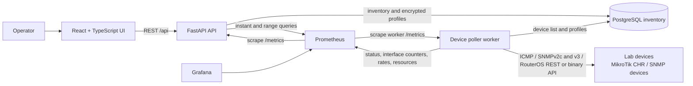

# MGKK Monitoring System Flow

## Presentation overview

MGKK Monitoring is a small, database-driven network inventory and reachability
monitor. Operators register devices in the web UI, choose how each device
should be checked, and review status, system data, and interface telemetry. A
separate worker performs checks and SNMP collection, persists inventory
snapshots in PostgreSQL, and exposes metrics for Prometheus.

## Architecture at a glance



The React development server proxies `/api` requests to FastAPI. In Docker
Compose, the API, worker, PostgreSQL, Prometheus, and Grafana communicate over
the Compose network. Redis is also part of the current Compose stack but is
not in the device polling or metrics flow.

## End-to-end device flow

1. **Register inventory.** In the UI, an operator creates a site and adds a
   device with a stable inventory name, management IP, optional vendor/model
   metadata, and poll interval. The database row ID is the device identity;
   the IP is an editable address, not a unique identifier.
2. **Choose a check and collector.** Select Ping only, SNMP, RouterOS API, or
   RESTCONF, then choose the generic SNMP, MikroTik, or Cisco telemetry
   collector. RouterOS API checks require the MikroTik collector; RESTCONF
   checks require the Cisco collector.
3. **Protect credentials.** A profile stores an SNMP community, RouterOS
   username/password, or Cisco RESTCONF/SSH username/password. SNMPv3 profiles
   support SHA/SHA-256 authentication and optional AES-128 privacy. All secrets
   are encrypted using the configured `ENCRYPTION_KEY`; profile responses never
   return them.
4. **Discover poll work.** Every worker tick, the poller reads active devices
   and their check profiles from PostgreSQL. Each device is checked when its
   own poll interval has elapsed.
5. **Check the device.**
   - **Ping:** `icmplib` sends three ICMP echo requests, each with a 2-second
     timeout. The worker container is granted `NET_RAW`.
   - **SNMP:** every SNMP collector uses the same system identity, uptime, and
     IF-MIB interface path. Generic CPU/memory use HOST-RESOURCES-MIB when
     available and ENTITY-SENSOR-MIB for environmental readings; MikroTik adds
     vendor resource and health metrics.
   - **Cisco:** SNMP reads CISCO-PROCESS-MIB, CISCO-MEMORY-POOL-MIB,
     CISCO-ENVMON-MIB, CISCO-CDP-MIB, and CISCO-STACKWISE-MIB in addition to
     the shared IF-MIB/LLDP path. IOS-XE RESTCONF is an optional check type.
   - **RouterOS API:** the MikroTik collector uses REST on RouterOS v7.1+ and
     the binary API-SSL service on v6. Port 8728 can be explicitly selected for
     an unencrypted API connection. It collects system resources, interfaces,
     aggregate DHCP/ARP/wireless data, and `ip/neighbor` adjacencies. TLS
     verification is enabled by default.
6. **Persist topology and dynamic data.** Discovered CDP, LLDP, and RouterOS
   neighbors are upserted into `device_neighbors`; stack members, DHCP leases,
   ARP entries, and wireless summaries are stored in `device_snapshots`.
   Prometheus receives aggregate counters only, never neighbor identities.
7. **Publish results.** Device checks expose `device_up`, `ping_latency_seconds`,
   and `ping_packet_loss_ratio`. Interface octet/error/discard metrics are
   Prometheus counters: each poll adds the positive delta from the saved
   SNMP/API counter, accounting for a counter reset or wrap.
   Prometheus `rate()` is used for traffic and error charts. Interface metrics
   have only `device`, `interface`, and `site` labels. Link utilization is
   computed from the observed traffic delta and discovered or operator-overridden
   `ifHighSpeed`. The worker also updates last-seen and system/interface
   snapshots in PostgreSQL.
8. **Display status and history.** Prometheus scrapes the API and worker.
   The UI gets inventory from FastAPI and the latest per-device check status
   from `/api/devices/status`; the API queries Prometheus for status and
   historical latency, packet-loss, and interface telemetry. The device detail
   view also shows discovered system/interface data from PostgreSQL snapshots.

## Main components

| Component | Responsibility |
|---|---|
| React + TypeScript | Inventory, encrypted profile management, interface list, traffic/error/discard charts, and bandwidth ranges |
| FastAPI | Validates inventory/profile/interface requests and queries Prometheus |
| PostgreSQL | Stores inventory, encrypted credentials, system snapshots, interface identities, speed overrides, discovered neighbors, and last counter samples |
| Poller worker | Runs checks, polls SNMP/RESTCONF/RouterOS telemetry, persists dynamic snapshots and topology, and exports metrics |
| Prometheus | Scrapes API/worker metrics and retains time-series data for status/history |
| Grafana | Included in Compose for dashboards using Prometheus as a data source |
| Redis | Included in Compose; not currently used by the device-monitoring flow |

## Data and metric flow

```text
UI --device/profile CRUD--> FastAPI --inventory/profile data--> PostgreSQL
                                  ^                                |
                                  |                                | poll targets
                                  |                                v
UI <--status/chart response-- FastAPI <--Prometheus query-- Prometheus
                                                            ^
                                                            | scrape metrics
Lab device <--check-- Poller worker ------------------------+
```

The worker exports `device_up` (1/0), `ping_latency_seconds` (seconds),
`ping_packet_loss_ratio` (0-1), interface byte/error/discard counters,
link-utilization gauges, and CPU/memory gauges for devices exposing supported
MIB data. The API applies
`rate()` to true monotonic counters for interface history. Interface series
use only `device`, `interface`, and `site` labels; IP addresses and arbitrary
tags are never labels.

## MikroTik lab walkthrough

For a demo, prepare a reachable CHR/router and configure it before adding it to
the UI:

1. Configure SNMP and/or enable the RouterOS API. REST requires v7.1+ and
   `www-ssl`; automatic v6 fallback uses API-SSL on 8729.
2. Create a dedicated read-only SNMP community or RouterOS monitoring user.
   Restrict service access to the poller host/network where practical.
3. Set `ENCRYPTION_KEY` in `.env`, then start the app and apply the
   Alembic migration.
4. Open **Credentials** in the UI and add an SNMP v2c/v3 or RouterOS API profile.
   For a self-signed lab certificate, TLS verification can be disabled for
   that profile; use a trusted certificate outside a lab.
5. Open **Devices**, add a router, select the MikroTik collector and matching
   check type/profile, and save it.
6. Open device details to show system name/description, uptime, CPU/memory when
   exposed by the vendor or standard MIB, discovered interfaces, traffic/errors/discards, current and
   peak throughput, and 24-hour/7-day/30-day bandwidth history after Prometheus
   has collected samples. Set a link-speed override for virtual/tunnel
   interfaces when `ifHighSpeed` is missing or inaccurate.
7. Open Grafana's provisioned **Generic Router/Switch Health**,
   **MGKK Network Telemetry**, or **MikroTik Router Health** dashboard to compare
   interface traffic, utilization, errors, and resources.

Follow [Phase 2 telemetry verification](./phase-2-verification.md) to compare
the app's rates with cumulative Linux SNMP counters and CHR interface
statistics. The procedure is not a claim that a live lab comparison was run.

For ICMP, the worker has `NET_RAW`. SNMP, RouterOS REST, and binary API use
UDP, HTTPS, and TCP respectively, so the poller container must also have IP
routing and firewall access to each lab device and service port. Docker Desktop on Windows may
require additional host/VM networking configuration; `docker compose up` alone
does not create a CHR or bridge a separate lab subnet.

## Demo talk track

The frontend **Guide** tab walks through Overview, Devices, device setup,
device details, credential profiles, and status troubleshooting. Use it as an
in-app orientation before the following demo:

1. Start on **Devices** and explain inventory identity versus the mutable
   management IP.
2. Show that each target has its own check type and polling interval.
3. Create or inspect a credential profile, noting that secrets are encrypted
   at rest and not returned to the UI.
4. Open a MikroTik device and explain that the worker independently checks it;
   the API remains responsive while polling runs.
5. Point out that Prometheus supplies the current status and the historical
   latency chart, while PostgreSQL holds the inventory and last-seen timestamp.
6. Mention the lab prerequisites: reachable management subnet, enabled
   RouterOS service, read-only credentials, and the encryption key.

## Current scope and caveats

- SNMP system and interface collection is implemented. MikroTik CPU/memory uses
  its vendor MIB; generic CPU/memory uses HOST-RESOURCES-MIB when available.
  Devices that do not implement these resource tables still provide system and
  interface telemetry, but their CPU/memory values remain unavailable.
- RouterOS REST is attempted first; failed REST access falls back to the
  RouterOS binary API-SSL on 8729. Port 8728 is available by explicit
  profile configuration. Wireless data is aggregated by interface;
  DHCP and ARP expose counts only, never client identity labels.
- Bandwidth history depends on Prometheus retention and is not backfilled before
  the poller first observes the interface.
- The Compose stack does not provision MikroTik CHR instances or SNMP test
  devices.
- Prometheus is the time-series source for device status and charts; the API's
  `/metrics` endpoint also reports API request metrics.
- Compose keeps Prometheus samples for 45 days so the 30-day bandwidth range is
  available with a retention buffer.
- The API does not currently authenticate UI users. Keep it on a trusted
  network and use read-only device credentials.
