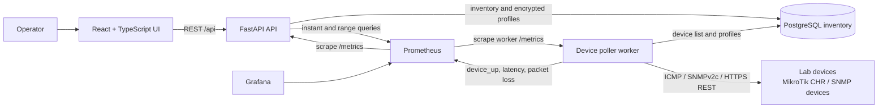

# MGKK Monitoring System Flow

## Presentation overview

MGKK Monitoring is a small, database-driven network inventory and reachability
monitor. Operators register devices in the web UI, choose how each device
should be checked, and review its latest status and latency. A separate worker
performs the checks and exposes metrics for Prometheus; the API combines
inventory from PostgreSQL with status and history from Prometheus.

## Architecture at a glance



The React development server proxies `/api` requests to FastAPI. In Docker
Compose, the API, worker, PostgreSQL, Prometheus, and Grafana communicate over
the Compose network. Redis is also part of the current Compose stack but is
not in the device polling or metrics flow.

## End-to-end device flow

1. **Register inventory.** In the UI, an operator creates a site and adds a
   device with a stable inventory name, management IP, optional vendor/model
   metadata, and poll interval. The database row ID is the device identity;
   the IP is an editable address, not a unique identifier.
2. **Choose a check.** Select Ping only, SNMP v2c, or RouterOS REST API.
   SNMP and RouterOS checks need a matching credential profile.
3. **Protect credentials.** A profile stores an SNMP community or RouterOS
   username/password. The API encrypts the secret using the configured
   `CREDENTIAL_ENCRYPTION_KEY`; profile responses never return the secret.
4. **Discover poll work.** Every worker tick, the poller reads active devices
   and their check profiles from PostgreSQL. Each device is checked when its
   own poll interval has elapsed.
5. **Check the device.**
   - **Ping:** `icmplib` sends three ICMP echo requests, each with a 2-second
     timeout. The worker container is granted `NET_RAW`.
   - **SNMP v2c:** the worker reads the standard `sysUpTime` OID over UDP.
   - **RouterOS REST:** the worker requests
     `/rest/system/resource` over HTTPS using HTTP Basic authentication and a
     5-second timeout. TLS verification is enabled by default per profile.
6. **Publish results.** The worker exposes `device_up`,
   `ping_latency_seconds`, and `ping_packet_loss_ratio`. Despite the historic
   `ping_` metric names, latency and up/down status also represent SNMP and
   RouterOS check results. Packet-loss data is meaningful only for ICMP checks.
   On success, the worker also updates the device's `last_seen_at` in
   PostgreSQL.
7. **Display status and history.** Prometheus scrapes the API and worker.
   The UI gets the inventory from FastAPI; the API queries Prometheus for the
   latest status and range data used by the device list and detail chart.

## Main components

| Component | Responsibility |
|---|---|
| React + TypeScript | Device inventory forms/list/detail, check selection, and credential profile management |
| FastAPI | Validates requests, serves inventory/profile CRUD, and queries Prometheus |
| PostgreSQL | Stores sites, devices, groups, poll settings, and encrypted credential profiles |
| Poller worker | Reads active targets, runs checks on schedule, and exports device metrics |
| Prometheus | Scrapes API/worker metrics and retains time-series data for status/history |
| Grafana | Included in Compose for dashboards using Prometheus as a data source |
| Redis | Included in Compose; not currently used by the device-monitoring flow |

## Data and metric flow

```text
UI --device/profile CRUD--> FastAPI --inventory/profile data--> PostgreSQL
                                  ^                                |
                                  |                                | poll targets
                                  |                                v
UI <--status/chart response-- FastAPI <--Prometheus query-- Prometheus
                                                            ^
                                                            | scrape metrics
Lab device <--check-- Poller worker ------------------------+
```

The worker exports `device_up` (1/0), `ping_latency_seconds` (seconds), and
`ping_packet_loss_ratio` (0-1). The API converts latency to milliseconds for
the UI. Device names and site codes are used as metric labels; IP addresses
and tags are not used as labels.

## MikroTik lab walkthrough

For a demo, prepare a reachable CHR/router and configure it before adding it to
the UI:

1. Configure SNMP and/or enable `www-ssl` on RouterOS.
2. Create a dedicated read-only SNMP community or RouterOS monitoring user.
   Restrict service access to the poller host/network where practical.
3. Set `CREDENTIAL_ENCRYPTION_KEY` in `.env`, then start the app and apply the
   Alembic migration.
4. Open **Credentials** in the UI and add an SNMP v2c or RouterOS API profile.
   For a self-signed lab certificate, TLS verification can be disabled for
   that profile; use a trusted certificate outside a lab.
5. Open **Devices**, add a router with vendor `mikrotik`, select the matching
   check type and profile, and save it.
6. Open the device details to show check type, latest status, latency, and
   history after Prometheus has collected samples.

For ICMP, the worker has `NET_RAW`. SNMP and RouterOS checks use UDP and HTTPS,
respectively, so the poller container must also have IP routing and firewall
access to each lab device and service port. Docker Desktop on Windows may
require additional host/VM networking configuration; `docker compose up` alone
does not create a CHR or bridge a separate lab subnet.

## Demo talk track

1. Start on **Devices** and explain inventory identity versus the mutable
   management IP.
2. Show that each target has its own check type and polling interval.
3. Create or inspect a credential profile, noting that secrets are encrypted
   at rest and not returned to the UI.
4. Open a MikroTik device and explain that the worker independently checks it;
   the API remains responsive while polling runs.
5. Point out that Prometheus supplies the current status and the historical
   latency chart, while PostgreSQL holds the inventory and last-seen timestamp.
6. Mention the lab prerequisites: reachable management subnet, enabled
   RouterOS service, read-only credentials, and the encryption key.

## Current scope and caveats

- SNMP currently performs an availability check by reading `sysUpTime`; full
  interface/system inventory collection is not implemented.
- RouterOS checks currently verify reachability and credentials by requesting
  `system/resource`; RouterOS values are not yet saved as inventory fields.
- The Compose stack does not provision MikroTik CHR instances or SNMP test
  devices.
- Prometheus is the time-series source for device status and charts; the API's
  `/metrics` endpoint also reports API request metrics.
- The API does not currently authenticate UI users. Keep it on a trusted
  network and use read-only device credentials.
